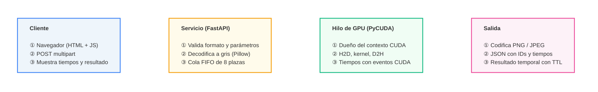

# Servicio Web de Convolución de Imágenes en GPU con Docker y PyCUDA


**Práctica de Laboratorio 03 — PA 69 · Computación Paralela · Universidad Politécnica Salesiana**
Docente: Ing. Gabriel A. León Paredes, PhD.

Integrantes: **Sebastián Sinchi** y **Rafael Serrano**

---

## RESUMEN (ABSTRACT)

**Problema:** el programa de convolución con PyCUDA de la práctica 02 solo se podía ejecutar como un script local. Ofrecerlo como servicio obliga a decidir cómo se gestiona el contexto CUDA, cómo se atienden varias solicitudes y cómo se despliega con acceso a la GPU.

**Propuesta:** se convierte el programa en un servicio web (FastAPI) empaquetado en una imagen Docker. Se conservan los kernels propios, los filtros (media 3×3/9×9/21×21, nitidez y laplaciano), la precisión `float32` y la extensión con ceros. Un único hilo trabajador es dueño del contexto CUDA y atiende una cola acotada; la interfaz web permite cargar una imagen, elegir el filtro, ver el resultado y descargarlo.

**Tecnologías:** Python 3.12, FastAPI, uvicorn, PyCUDA, CUDA 13.4, Pillow, Docker con NVIDIA Container Toolkit y `uv` para las dependencias fijas.

**Resultados (RTX 3060 Laptop):** el resultado del servicio en Docker es idéntico bit a bit al de la ejecución directa (error máximo y medio 0,0). En media 9×9 sobre 4000×4000 el servidor tarda ≈ 344 ms y la GPU solo 7,5 ms (2,2 %): el cuello de botella pasa a ser la decodificación y, sobre todo, la codificación PNG. Con 4 clientes simultáneos el servicio atiende 7,4 solicitudes/s frente a 2,8 con uno, sin rechazos. Las conclusiones se limitan al hardware y a las configuraciones evaluadas.

---

## ARQUITECTURA DE LA SOLUCIÓN



### Decisiones de diseño
| Decisión | Elección | Motivo |
|---|---|---|
| Servidor | FastAPI + uvicorn, 1 proceso, sin `--reload` ni depurador | Un proceso = un contexto CUDA y una copia de la VRAM |
| Separación HTTP / cálculo | `app/main.py` (HTTP) y `app/gpu/` (motor sin HTTP) | El mismo motor se usa directo (`app.cli`) y desde el servicio |
| Concurrencia | Un hilo dueño del contexto + cola FIFO de 8 plazas | La GPU se usa en exclusiva; cola llena → `429` en lugar de memoria sin límite |
| CPU fuera del hilo de GPU | Decodificar y codificar en un pool de hilos | La CPU de una solicitud se solapa con la GPU de otra |
| Sin GPU | El servicio arranca y responde `503` con el diagnóstico | Nunca sustituye por CPU |
| Duplicados | `id_solicitud` idempotente y botón bloqueado al enviar | Un reintento no vuelve a procesar |
| Archivos temporales | Un archivo por resultado (UUID), escritura atómica, TTL 15 min, tope 20 | Sin sobrescrituras entre solicitudes |

### Distribución del procesamiento en CUDA
- Bloques e hilos en el eje X, un hilo por píxel de salida (distribución de la práctica 02).
- Índice global `idx = blockIdx.x * blockDim.x + threadIdx.x`; fila `idx / width`, columna `idx % width`.
- Los hilos con `idx >= width * height` no hacen nada; el número de bloques es `ceil(width*height / hilos_por_bloque)`.
- Imagen leída desde memoria global; arreglos de entrada y salida separados.
- Tratamiento de bordes: extensión con ceros.

### Kernels
| Kernel | Función | Origen |
|---|---|---|
| `convolucionGPU` | Convolución 2D en `float32` | Práctica 02, **texto idéntico** |
| `u8_a_float` | Convierte la imagen `uint8` a `float32` en la GPU | Nuevo (auxiliar, no es un filtro) |
| `float_a_u8` | Aplica el desplazamiento (+128 en laplaciano), trunca y recorta a [0, 255] | Nuevo (auxiliar, misma regla que la práctica 02) |

Los kernels auxiliares evitan recorrer hasta 36 Mpx en Python y reducen 4× las transferencias; se miden aparte (`auxiliares_gpu_ms`).

### Filtros implementados
| Filtro | Máscara |
|---|---|
| Media k×k | todos los coeficientes `1/(k·k)` (k = 3, 9, 21) |
| Nitidez 3×3 | `[0 -1 0; -1 5 -1; 0 -1 0]` |
| Laplaciano 3×3 | `[0 1 0; 1 -4 1; 0 1 0]` |

### Relación con la práctica 02
| Elemento | Práctica 02 | Práctica 03 |
|---|---|---|
| Entrada | Archivos JPEG leídos del disco | POST multipart validado (formato, tamaño, dimensiones, parámetros) |
| Contexto CUDA | En el hilo principal del script | Un hilo trabajador dueño del contexto |
| Transferencias | `float32` | `uint8` (el kernel de convolución sigue en `float32`) |
| Protocolo | 1 calentamiento + 5 repeticiones | 1 ejecución en frío + 1 calentamiento + 10 repeticiones |
| Despliegue | Local | Imagen Docker con GPU |

---

## Trazabilidad

| Elemento | Valor |
|---|---|
| Repositorio práctica 02 | https://github.com/elsebasdev1/image_convolution_processing |
| Commit de origen práctica 02 | `fb95088d827a9e62ab2ba80d0b6fe78bc625a069` (kernel `convolucionGPU` copiado sin cambios) |
| Commit práctica 03 | `git rev-parse HEAD`; la imagen lo guarda en la etiqueta `org.opencontainers.image.revision` |

---

## Equipo utilizado

| Componente | Especificación |
|---|---|
| Equipo | ASUS ROG Flow X16 GV601RM (portátil, servidor local) |
| CPU | AMD Ryzen 9 6900HS with Radeon Graphics (16 hilos) |
| RAM | 30,6 GiB |
| GPU | NVIDIA GeForce RTX 3060 Laptop (6144 MiB, 30 SMs, cc 8.6) |
| Driver NVIDIA | 620.73.04 |
| SO | Arch Linux (kernel 7.3.5) |
| Docker / Toolkit | Docker 29.10.0 · NVIDIA Container Toolkit 1.20.2 (runtime `nvidia`) |
| Anfitrión: Python / `nvcc` | 3.12.16 · 13.5.37 |
| Imagen: Python / `nvcc` / PyCUDA | 3.12.3 · 13.4.92 · 2026.1 |

### Compatibilidad (controlador del anfitrión vs. CUDA de la imagen)
| Componente | Quién lo aporta | Versión |
|---|---|---|
| Controlador NVIDIA (módulo del kernel + `libcuda`) | **Anfitrión** (inyectado por NVIDIA Container Toolkit) | 620.73.04 (CUDA 13.5) |
| Toolkit CUDA (`nvcc`, cabeceras) | **Imagen** `nvidia/cuda:13.4.3-devel-ubuntu24.04` | 13.4.3 |
| Python y dependencias | Imagen (`uv.lock`, versiones exactas) | 3.12 |

El controlador del anfitrión debe soportar una versión de CUDA mayor o igual a la del toolkit de la imagen. La imagen es `-devel` porque PyCUDA invoca `nvcc` al arrancar.

---

## Validación de resultados

Tolerancia: **10⁻²** (error absoluto), la misma de la práctica 02. Resultado: **24 de 24 pruebas superadas** (`resultados/validacion.csv`).

| Prueba | Descripción | Resultado |
|---|---|---|
| 1. Manual | Laplaciano sobre matriz 3×3 (valores 1–9) calculado a mano vs GPU (4 hilos/bloque) | idéntico |
| 2. Dimensiones no múltiplos | Imagen 1237×911 (251 píxeles sobre 256 hilos/bloque); salida inicializada con NaN | 0 píxeles sin procesar; CPU(double) vs GPU(float32): err. máx. 2.33e-05, medio 6.11e-06 |
| 3. Directo vs servicio | 4000×4000, 5 configuraciones, `float32` antes del recorte | error máximo y medio **0,0**; PNG con el mismo SHA-256 |
| 4. Entradas inválidas | Archivo inválido, vacío, demasiado grande (413), imagen demasiado grande (413), filtro desconocido, máscara no permitida (×2), hilos no permitidos | 400 · 400 · 413 · 413 · 422 · 422 · 422 · 422 |
| 5. Aislamiento | 4 solicitudes simultáneas (2000² y 4000², 4 filtros distintos) | cada una recibe su resultado; 4 `id_resultado` distintos |
| 6. Duplicados | Mismo `id_solicitud` dos veces | mismo resultado, sin reprocesar |

Además, `pytest` ejecuta 34 casos (HTTP, límites, idempotencia, aislamiento y GPU) en el anfitrión y dentro del contenedor.

---

## Metodología de medición

- Por configuración: **1 ejecución en frío + 1 calentamiento + 10 repeticiones medidas**; se reporta la **mediana** y la **desviación estándar** (cuartiles y extremos en `resumen.csv`).
- GPU: tiempos separados H2D, kernel, kernels auxiliares y D2H con eventos CUDA, sincronizando antes de leer.
- Servidor y cliente: `time.perf_counter()` (reloj monotónico). Total del cliente = subida + respuesta JSON + descarga del PNG.
- Excluido: inicialización del contexto y compilación de los kernels (se miden aparte en `arranque.csv`).
- Cliente en la misma máquina (loopback): la red no aporta latencia.
- Experimentos: **8.1** modos (anfitrión, contenedor, servicio), **8.2** resolución, **8.3** filtros y máscaras, **8.4** concurrencia (1, 2 y 4 clientes; rendimiento = solicitudes exitosas ÷ intervalo de la ronda).

---

## Resultados (tiempos en ms, mediana de 10 repeticiones)

**Experimento 8.1 — Integración y contenedor** (media 9×9, 4000×4000, 256 hilos/bloque)

| Modo | Kernel | GPU total | Decod. | Codif. | Proceso / servidor | Cliente |
|---|---|---|---|---|---|---|
| PyCUDA directo, anfitrión | 3,910 ± 0,000 | 7,35 | 66,0 | 290,6 | 371,6 | — |
| PyCUDA directo, contenedor | 3,910 ± 0,000 | 7,53 | 64,1 | 257,4 | 336,1 | — |
| Servicio contenerizado | 3,910 ± 0,001 | 7,46 | 64,2 | 258,5 | 344,4 | 363,6 |

**Experimento 8.2 — Resolución** (media 9×9, servicio contenerizado)

| Resolución | Kernel | H2D | D2H | Servidor | Cliente | Desv. servidor |
|---|---|---|---|---|---|---|
| 2000×2000 | 0,982 ± 0,001 | 0,42 | 0,43 | 92,1 | 99,8 | 0,7 |
| 4000×4000 | 3,909 ± 0,001 | 1,52 | 1,42 | 338,1 | 356,5 | 4,3 |
| 6000×6000 | 8,783 ± 0,001 | 3,17 | 3,47 | 729,0 | 761,9 | 6,0 |

**Experimento 8.3 — Filtros y máscaras** (4000×4000, servicio contenerizado)

| Filtro | Kernel | GPU total | Decod. | Codif. | Servidor | Cliente |
|---|---|---|---|---|---|---|
| Media 3×3 | 0,690 ± 0,000 | 4,23 | 56,4 | 291,2 | 365,9 | 387,0 |
| Media 9×9 | 3,909 ± 0,001 | 7,51 | 57,7 | 256,9 | 335,6 | 355,6 |
| Media 21×21 | 20,787 ± 0,001 | 24,29 | 57,2 | 236,0 | 330,3 | 347,8 |
| Nitidez 3×3 | 0,690 ± 0,000 | 4,21 | 57,3 | 416,3 | 494,5 | 522,4 |
| Laplaciano 3×3 | 0,690 ± 0,001 | 4,28 | 56,3 | 400,3 | 477,9 | 503,8 |

**Experimento 8.4 — Solicitudes concurrentes** (media 9×9, 4000×4000, 10 rondas)

| Clientes | Latencia cliente | IQR | Cola | Servidor | Solicitudes/s | Rechazos · fallos |
|---|---|---|---|---|---|---|
| 1 | 354 | 353–356 | 0,05 | 335 | 2,82 | 0 · 0 |
| 2 | 436 | 434–438 | 4,36 | 403 | 4,55 | 0 · 0 |
| 4 | 533 | 528–537 | 15,76 | 470 | 7,38 | 0 · 0 |

**Arranque del motor** (contexto CUDA + compilación, 5 arranques): anfitrión 367 ms; contenedor nuevo 467 ms.

Hallazgos principales:
1. El kernel es idéntico en anfitrión, contenedor y servicio (3,91 ms): Docker no añade costo en la GPU. La diferencia de CPU entre anfitrión y contenedor no se puede atribuir a Docker (cambian Python, Pillow y `nvcc`).
2. El kernel escala con los píxeles y con k² (0,69 → 20,79 ms de 3×3 a 21×21), pero la latencia del servicio casi no cambia.
3. La GPU es el 2,2 % del tiempo del servidor; decodificar es el 18,6 % y codificar el PNG el 75,1 %. El PNG de nitidez pesa el doble que el de media y codificarlo tarda 416 ms frente a 257 ms.
4. Con más clientes sube el rendimiento (2,8 → 7,4 solicitudes/s) y la latencia individual (354 → 533 ms), sin rechazos ni fallos.
5. La VRAM necesaria es ≈ 10 bytes/píxel (38 MB, 153 MB y 343 MB para 2000², 4000² y 6000²); es un cálculo, no una medición.

---

## Compilación y ejecución

### Prerrequisitos
- GPU NVIDIA con driver instalado (el contenedor aporta el toolkit CUDA)
- Docker, Docker Compose v2 y **NVIDIA Container Toolkit** (`sudo nvidia-ctk runtime configure --runtime=docker && sudo systemctl restart docker`)
- Para la ejecución directa: `uv` y CUDA Toolkit con `nvcc` en el `PATH`

### Levantar el servicio (Docker)
```bash
make up       # construye la imagen, arranca con GPU y espera: http://localhost:8000
make down     # detiene el contenedor
```

| Comando | Función |
|---|---|
| `make up` / `make down` / `make restart` | Construye y arranca / detiene / reinicia |
| `make logs` / `make status` | Registros / estado del contenedor y de la GPU |
| `make gpu` | Verifica `nvidia-smi`, `nvcc` y PyCUDA dentro del contenedor |
| `make test` | Ejecuta las pruebas dentro del contenedor |
| `make medir` | Protocolo completo: anfitrión, contenedor, servicio, concurrencia y validación |
| `scripts/probar_sin_gpu.sh` | El mismo contenedor sin `--gpus all`: `503 gpu_no_disponible` |

Equivalente manual:
```bash
docker build --build-arg GIT_COMMIT=$(git rev-parse HEAD) -t convolucion-gpu:1.0 .
docker run --rm --gpus all -p 8000:8000 convolucion-gpu:1.0
```

### Ejecución directa (anfitrión)
```bash
uv sync                                   # crea .venv con las versiones de uv.lock
uv run python -m app.cli --info           # GPU y versiones
uv run python -m app.cli datos/imagenes/extra2_4000.jpeg --filtro media --mascara 9 --reps 6 --salida /tmp/salida.png
uv run python -m app                      # servicio en http://localhost:8000
uv run pytest                             # pruebas (las de GPU se omiten si no hay GPU)
```

### Reproducir las mediciones
```bash
uv run python -m bench.directo --modo directo_host
docker run --rm --gpus all --user $(id -u):$(id -g) -e HOME=/tmp -v "$PWD/datos:/app/datos:ro" -v "$PWD/resultados:/app/resultados" \
  convolucion-gpu:1.0 python -m bench.directo --modo directo_contenedor
uv run python -m bench.cliente --modo servicio_contenedor --url http://localhost:8000
uv run python -m bench.resumir
uv run python -m bench.validacion
```

### Verificar desde una copia limpia
```bash
git clone https://github.com/elsebasdev1/image_convolution_docker_pycuda.git /tmp/p3 && cd /tmp/p3
docker build --build-arg GIT_COMMIT=$(git rev-parse HEAD) -t convolucion-gpu:1.0 .
scripts/verificar_gpu_contenedor.sh && scripts/probar_sin_gpu.sh
```

---

## Preparación de datos

Las imágenes no se versionan. Se usan **las mismas de la práctica 02** (`imagenes/extras/extra2_{2000,4000,6000}.jpeg` de [image_convolution_processing](https://github.com/elsebasdev1/image_convolution_processing)): copiarlas a `datos/imagenes/` y comprobar el SHA-256 (`cd datos/imagenes && sha256sum extra2_*.jpeg`).

| Archivo | Resolución | SHA-256 |
|---|---|---|
| `extra2_2000.jpeg` | 2000×2000 | `2bd12124f9266285012baf4be2e65e6e931fff60cd22ece5b94b889a1d92906b` |
| `extra2_4000.jpeg` | 4000×4000 | `1bfe684b4fc7629d0aa7125b730801d2a6dbaa963f1ca9173d1ea504729c5429` |
| `extra2_6000.jpeg` | 6000×6000 | `a6ecf0cd9abdd2871e00cf03df7aeddeb45f3aaa4137505c693ff22ebc1ce5aa` |

---

## API HTTP

Base: `http://<host>:8000`. Interfaz web en `/` y documentación OpenAPI en `/docs`. Los errores devuelven JSON:
`{"estado":"error","error":{"codigo":"…","mensaje":"…"},"id_solicitud":"…"}`.

### POST `/api/v1/convolucion` (multipart/form-data)

| Campo | Obligatorio | Valores | Notas |
|---|---|---|---|
| `imagen` | sí | JPEG, PNG, BMP; ≤ 32 MB; ≤ 36 Mpx; lado 3…8000 | Se convierte a gris con `convert("L")` |
| `filtro` | sí | `media`, `nitidez`, `laplaciano` | |
| `mascara` | no (3) | media: `3`, `9`, `21`; nitidez/laplaciano: solo `3` | |
| `hilos` | no (256) | `64,128,256,512,1024` | bloques = ⌈píxeles/hilos⌉ en X |
| `formato` | no (`png`) | `png`, `jpeg` (q=100), `raw32` | `raw32` = `float32` antes del recorte (validación) |
| `id_solicitud` | no | `[A-Za-z0-9_-]{8,64}` (o cabecera `X-Id-Solicitud`) | idempotencia; si falta lo genera el servidor |

```bash
curl -F imagen=@datos/imagenes/extra2_4000.jpeg -F filtro=media -F mascara=9 http://localhost:8000/api/v1/convolucion
```

**200** — ejemplo abreviado:

```json
{"estado":"ok","id_solicitud":"…","id_resultado":"…","filtro":"media","mascara":9,
 "hilos_por_bloque":256,"bloques":62500,
 "entrada":{"ancho":4000,"alto":4000,"formato":"JPEG","bytes":3383378,"sha256":"…"},
 "salida":{"formato":"png","mime":"image/png","bytes":5584431,"sha256":"…","url":"/api/v1/resultados/<id>",
           "url_descarga":"…?descargar=true","url_meta":"…/meta"},
 "tiempos":{"unidad":"ms","recepcion_ms":…,"decodificacion_ms":…,"cola_ms":…,"reserva_ms":…,"h2d_ms":…,
            "kernel_ms":…,"auxiliares_gpu_ms":…,"d2h_ms":…,"gpu_total_ms":…,"seccion_gpu_ms":…,
            "codificacion_ms":…,"servidor_ms":…}}
```

Tiempos (todos en **ms**): `h2d`, `kernel`, `auxiliares` y `d2h` con eventos CUDA; `recepcion` (llegada → manejador, incluye la subida), `decodificacion`, `cola`, `reserva`, `seccion_gpu`, `codificacion` y `servidor` con reloj monotónico. Cabeceras: `X-Id-Solicitud`, `Server-Timing`. Un `id_solicitud` repetido con el mismo contenido devuelve la respuesta original con `X-Solicitud-Duplicada: true`.

| HTTP | `codigo` | Causa |
|---|---|---|
| 400 | `archivo_invalido` | vacío, no es imagen o está corrupto |
| 409 | `id_solicitud_en_conflicto` | mismo id con otra imagen o parámetros |
| 413 | `archivo_demasiado_grande`, `imagen_demasiado_grande` | bytes, píxeles o lado sobre el límite |
| 415 | `formato_no_soportado` | formato distinto de JPEG/PNG/BMP |
| 422 | `parametro_invalido`, `dimensiones_invalidas` | filtro, máscara, hilos, formato o id inválidos; lado < 3 |
| 429 | `cola_llena` | cola de la GPU llena (`Retry-After: 2`) |
| 500 | `error_procesamiento` | fallo CUDA durante el procesamiento |
| 503 | `gpu_no_disponible`, `memoria_gpu_insuficiente` | sin GPU/contexto (diagnóstico en `mensaje`) o VRAM insuficiente |
| 504 | `tiempo_cola_agotado` | esperó más de `TIEMPO_MAX_COLA_S` en cola |

### Otras rutas

| Ruta | Función |
|---|---|
| `GET /api/v1/resultados/{id}` | Imagen del resultado; `?descargar=true` la entrega como adjunto; `/meta` devuelve su JSON. `404` si no existe o expiró (TTL 15 min) |
| `GET /api/health` | Estado (`ok` / `sin_gpu`), datos de la GPU o su error, cola, límites y versiones |

Límites configurables en `app/config.py`: 32 MB por archivo, 36 Mpx, lado ≤ 8000, cola de 8, resultados 15 min / 20 archivos.

---

## 📂 Estructura del Repositorio

```
├── app/                        # Servicio y motor de GPU
│   ├── main.py                 # Rutas HTTP (FastAPI)
│   ├── imagen.py               # Validación y E/S de imágenes (Pillow)
│   ├── almacen.py              # Resultados temporales (UUID, TTL)
│   ├── config.py               # Límites y parámetros
│   ├── cli.py                  # Ejecución directa del mismo motor
│   └── gpu/
│       ├── kernels.py          # Kernels CUDA propios y máscaras
│       ├── convolucion.py      # Contexto, memoria, transferencias y eventos (sin HTTP)
│       ├── trabajador.py       # Hilo dueño del contexto + cola acotada
│       └── referencia_cpu.py   # Convolución secuencial de referencia (pruebas)
├── web/                        # Interfaz HTML + CSS + JS sin framework
├── tests/                      # Pruebas HTTP, motor y equivalencia
├── bench/                      # Mediciones, concurrencia y validación
├── scripts/                    # Construcción, GPU en contenedor, protocolo completo
├── resultados/                 # CSV de mediciones, resumen, validación y evidencias
├── Dockerfile
├── docker-compose.yml
├── Makefile
├── pyproject.toml
├── uv.lock
└── README.md
```
